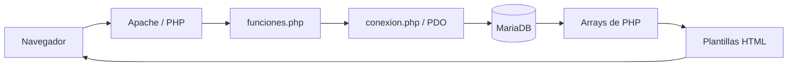

# Cómo entender este CRUD

El proyecto está completo para poder ejecutarlo y estudiarlo. No necesitás memorizar
todo junto: leé una sección, abrí el archivo indicado y seguí los ejercicios.
Usamos PHP normal, PDO, MariaDB, HTML y CSS, sin frameworks ni Composer.

## 1. El recorrido de una petición



Cuando abrís `index.php`, Apache ejecuta PHP. PHP consulta MariaDB y construye
HTML. El navegador recibe ese HTML; no recibe el código PHP ni la contraseña.
`require_once` carga un archivo una sola vez. `__DIR__` representa la carpeta del
archivo actual, así que las inclusiones no dependen de dónde ejecutaste PHP.

Al enviar un formulario, el navegador manda un POST a `script.php`. Ese archivo
valida los datos, ejecuta la acción y redirige a otra pantalla. La respuesta 303
indica que la próxima petición debe ser GET. Así, actualizar la pantalla final
no repite el alta o el borrado.

## 2. Qué hace cada archivo

| Archivo | Responsabilidad |
| --- | --- |
| `src/index.php` | Lee filtros por GET, consulta productos con JOIN y muestra una tabla y el resumen. |
| `src/new.php` | Prepara valores vacíos o recupera un intento con errores; muestra el formulario de alta. |
| `src/show.php` | Valida el ID de la URL, busca una fila y muestra su detalle. |
| `src/edit.php` | Busca el producto y precarga el mismo formulario con sus valores actuales. |
| `src/delete.php` | Muestra qué se va a borrar y pide confirmación mediante POST. |
| `src/marcas.php` | Lista, crea, edita y presenta la confirmación para eliminar marcas. |
| `src/script.php` | Recibe POST y decide qué acción ejecutar; valida token, acción, IDs y campos. |
| `src/funciones.php` | Inicializa sesión, contiene consultas reutilizables, validaciones y ayudas. |
| `src/conexion.php` | Crea el objeto PDO usando las variables que Docker pasa al proceso. |
| `src/partials/header.php` | Abre el HTML, muestra navegación y un mensaje de sesión si existe. |
| `src/partials/footer.php` | Cierra el contenido y muestra el pie compartido. |
| `src/partials/formulario-producto.php` | Campos comunes al alta y edición; evita duplicar todo el formulario. |
| `src/assets/css/estilos.css` | Colores, paneles, tablas, formularios y ajustes para móvil. |
| `database/database.sql` | Define columnas, claves, restricciones y relación. No borra tablas. |
| `database/seed.sql` | Agrega ejemplos si sus nombres no existen. |
| `scripts/init-db.sh` | Prepara esquema y permisos en volúmenes antiguos; `--seed` agrega ejemplos. |
| `tests/smoke.py` | Prueba las pantallas y acciones reales por HTTP, con cookies y token. |
| `Dockerfile` | Construye la imagen web con PHP, Apache y `pdo_mysql`. |
| `compose.yaml` | Coordina web, base y phpMyAdmin, puertos, variables y volumen persistente. |
| `.env.example` / `.env` | Plantilla compartida / configuración local que no se sube. |
| `.gitignore` | Evita versionar configuración local, backups y archivos generados. |
| `.dockerignore` | Evita copiar secretos y archivos innecesarios al contexto de construcción. |
| `AGENTS.md` | Instrucciones de trabajo y enseñanza para futuras sesiones. |

## 3. La base de datos y sus claves

Una fila de `marcas` puede ser `{id: 1, marca: Sony}`.
Una fila de `productos` puede guardar `{id: 7, nombre: Auriculares, marca_id: 1}`.
No son el mismo ID: `productos.id` identifica al producto y `marca_id` apunta a
otra tabla. Una marca puede tener muchos productos: relación **uno a muchos**.

`PRIMARY KEY` identifica una fila sin repetir el ID. `AUTO_INCREMENT` genera el
próximo número automáticamente; puede dejar huecos, y eso es normal.
`FOREIGN KEY` exige que la marca exista. `ON DELETE RESTRICT` bloquea borrar una
marca usada; primero reasigná o eliminá sus productos.
`UNIQUE` impide marcas duplicadas incluso si dos formularios llegan al mismo tiempo.
La comparación de marcas no distingue mayúsculas y minúsculas.

El precio es `DECIMAL(12,2)`: 12 dígitos en total, 2 de ellos decimales.
Acepta de `0` a `9999999999.99`. Conservamos el precio como texto al enviarlo a
MariaDB para no convertir cálculos monetarios a FLOAT. `number_format` solo
convierte a número para presentar `$ 1.234,50`; no cambia el valor almacenado.
No ingreses separadores de miles: escribí `1234.50`.

`fecha_carga` se genera con `CURRENT_TIMESTAMP` al crear el producto. La edición
no la modifica. En este entorno las fechas se presentan en UTC.

## 4. Cómo funciona el JOIN

```sql
SELECT p.id, p.nombre, m.marca, p.precio
FROM productos AS p
INNER JOIN marcas AS m ON p.marca_id = m.id;
```

`p` y `m` son nombres cortos de las tablas. `ON` explica qué columnas se relacionan.
`m.marca` trae el nombre, por eso la pantalla puede mostrar Sony en lugar de `1`.
No copia la marca al producto: la combina al consultar. Cambiar el nombre de una
marca se refleja al volver a leer sus productos.

Para listar marcas usamos `LEFT JOIN`, porque una marca sin productos también debe
aparecer. `COUNT(p.id)` cuenta sus productos; si no hay ninguno, devuelve `0`.

## 5. GET y POST

```php
// URL: show.php?id=3
$_GET['id']; // La cadena '3'. Todavía hay que validar que sea un ID permitido.
```

El signo `?` inicia los parámetros de la URL. `&` separa varios:
`index.php?q=Sony&estado=activo`. GET sirve para leer, buscar y elegir un registro.

```html
<form action="script.php" method="POST">
    <input name="nombre">
</form>
```

`name` define la clave que PHP recibe: `$_POST['nombre']`. POST envía campos en el
cuerpo de la petición. No es cifrado por sí mismo; HTTPS cifra el transporte.
Los inputs hidden también se pueden cambiar: nunca sustituyen la validación.
Visitar `delete.php?id=3` solo muestra la confirmación. Borrar por GET sería peligroso:
un enlace, un rastreador o una precarga podrían borrar datos sin confirmación.

## 6. PDO y consultas preparadas

`DB_HOST` es el servidor (`db` dentro de Docker), `DB_NAME` la base, `DB_USER` el
usuario y `DB_PASSWORD` su contraseña. PHP no interpreta `.env` directamente:
Compose lo lee y pasa los campos declarados en `environment`.

```php
$consulta = $pdo->prepare('SELECT * FROM productos WHERE id = ?');
$consulta->execute([$id]);
$producto = $consulta->fetch();
```

`prepare` define la consulta. `?` reserva el lugar de un valor.
`execute` manda los datos por separado. Si el usuario intenta mandar SQL como
texto, sigue siendo un valor y no se convierte en instrucciones. Esto evita
inyección SQL; no evita HTML malicioso ni reemplaza la validación de campos.

`fetch()` obtiene una fila o `false`. `fetchAll()` obtiene un array con todas las
filas. Con `PDO::FETCH_ASSOC`, cada fila tiene claves como `nombre` o `marca`.
`foreach ($productos as $producto)` recorre las filas para generar el HTML.
`<?= h($producto['nombre']) ?>` equivale a imprimir el valor escapado.

## 7. Funciones reutilizables

| Función | Qué hace |
| --- | --- |
| `obtenerProductos` | SELECT con JOIN; agrega filtros y parámetros cuando corresponden. |
| `obtenerProductoPorId` | SELECT con `WHERE p.id = ?`; devuelve una fila o null. |
| `obtenerMarcas` | Lista marcas con cantidad de productos. |
| `obtenerMarcaPorId` | Busca una marca por ID. |
| `obtenerResumen` | Cuenta total, activos e inactivos sin aplicar los filtros de pantalla. |
| `crearProducto` | INSERT y devolución del ID nuevo con `lastInsertId()`. |
| `editarProducto` | UPDATE de los cuatro campos editables del producto. |
| `eliminarProducto` | DELETE limitado a un ID. |
| `crearMarca`, `editarMarca`, `eliminarMarca` | Las tres escrituras equivalentes para marcas. |
| `validarProducto` | Devuelve los valores normalizados y un array de errores por campo. |
| `textoEntrada` | Recupera texto; rechaza arrays donde se esperaba una cadena. |
| `idValido` | Admite enteros positivos en el rango de INT UNSIGNED o devuelve null. |
| `h` | Escapa texto al colocarlo en HTML. |
| `precioFormateado` | Presenta dinero con coma decimal y punto de miles. |
| `tokenCsrf`, `csrfValido` | Generan y verifican el token ligado a la sesión. |
| `mensaje` | Guarda un aviso para la pantalla siguiente. |
| `guardarFormulario`, `recuperarFormulario` | Conservan valores y errores al redirigir. |
| `redirigir` | Envía una respuesta 303 y termina la ejecución. |
| `noEncontrado` | Muestra un error 404 y evita continuar con un registro ausente. |

`PDO $pdo`, `int $id` y `: array` son tipos: indican lo que una función espera y
devuelve. `?array` permite un array o null. `void` significa que no devuelve un
valor. No hay clases propias, repositorios ni controladores de un framework.

## 8. Validaciones, mensajes y seguridad básica

- HTML usa `required`, `maxlength`, `min` y `step` para orientar al usuario.
- PHP vuelve a validar: el navegador no es una autoridad sobre los datos.
- La base refuerza unicidad, relación, estados y precio no negativo.
- Un token CSRF evita que otro sitio envíe un formulario válido usando tu sesión.
- `h()` convierte `<` y comillas para que texto externo no se ejecute como HTML.
- La cookie de sesión es HttpOnly y SameSite Lax; en HTTPS también es Secure.
- Una política CSP limita scripts y recursos a lo permitido por la aplicación.
- Los errores inesperados muestran una respuesta genérica; no revelamos claves ni SQL.

En `script.php` se captura el código MariaDB `1062` para marca duplicada, `1451`
para marca en uso y `1452` si la marca de un producto desapareció durante el envío.
Otros errores se vuelven a lanzar: ocultarlos como si fueran validaciones exitosas
haría más difícil encontrar el problema.

Este catálogo es de práctica local, sin login, roles ni paginación. La búsqueda
devuelve todos los resultados y no está pensada para millones de registros.
Antes de exponerlo a otros usuarios haría falta incorporar autenticación,
autorización, HTTPS, límites y una configuración de despliegue.

## 9. Orden para estudiar y comprobar

1. **Base:** leé `database.sql`, identificá PK/FK y practicá INSERT/SELECT.
2. **Relación:** ejecutá el JOIN anterior y comparalo con `SELECT * FROM productos`.
3. **Conexión:** abrí `conexion.php` y explicá qué contiene `$pdo`.
4. **Listado:** seguí `$productos` desde la consulta hasta el foreach.
5. **Detalle:** abrí un producto desde Ver y cambiá el ID por `abc`; debe responder 404.
6. **Alta:** creá un producto y mirá cómo viajan los nombres de campos por POST.
7. **Edición:** cambiá precio y estado; volvé a Ver y comprobá que la fecha no cambió.
8. **Borrado:** entrá a Eliminar y cancelá; el producto debe seguir existiendo.
9. **Funciones:** buscá qué pantallas llaman a `obtenerProductoPorId`.
10. **Mejoras:** intentá un precio negativo y borrar una marca con productos.

### Ejercicios para explicárselo al profesor

1. ¿Por qué `productos.id` y `productos.marca_id` pueden tener valores distintos?
2. Agregá una marca desde la pantalla. ¿Aparece en el select sin cambiar HTML?
3. Cambiá el nombre de esa marca. ¿Por qué el detalle del producto se actualiza?
4. ¿Qué pasaría si quitaras `WHERE id = ?` de un DELETE? Explicalo sin ejecutarlo.
5. ¿Qué diferencia hay entre `fetch()` y `fetchAll()`?
6. ¿Por qué POST, consulta preparada, token CSRF y escape HTML resuelven problemas diferentes?
7. Escribí un SELECT de productos activos y compará el resultado con el filtro.

Consultá [SQL](SQL.md), [Docker](DOCKER.md), [Git](GIT.md) y [pruebas](PRUEBAS.md)
para los comandos y la verificación paso a paso.
